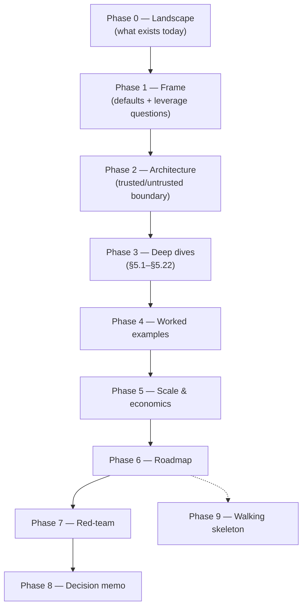

# ProofAgent — Design Set

**Mission (one paragraph).** Design, in implementable detail, an agentic theorem-proving and discovery
system on **Lean 4 + Mathlib** that accepts problems from any field, formalizes them in Lean, plans and
solves them with tools and agent societies up to extreme scale, remembers every episode, senses the
world through gated interfaces, and originates problems nobody specified — while the **Lean kernel
remains the only judge of truth**. The design's spine is a single rule: *untrusted agents propose; the
trusted kernel disposes.* This `docs/` set is the design-team's answer to the brief
([Master Prompt …](file:///d:/projects-shubham/02.06.2026/personal_projects/proof-agent/Master%20Prompt%20Design%20an%20Agentic%2C%20Curious%2C%20Memory-Rich%20Theorem-Proving%20System%20on.md)),
produced across the brief's Phases 0–9.

---

## New here? Start with the Reader's Guide

The phase files below are the **expert reference**. If you are new to the project — or want the same
design explained at your own level, from a curious high-schooler to a seasoned researcher — read the
**[Reader's Guide](file:///d:/projects-shubham/02.06.2026/personal_projects/proof-agent/docs/guide/README.md)** first:

| Level | File | For |
|---|---|---|
| T0 | [t0-high-schooler.md](file:///d:/projects-shubham/02.06.2026/personal_projects/proof-agent/docs/guide/t0-high-schooler.md) | Absolute beginner — what a proof is, why a computer checks one, what this is |
| T1 | [t1-intuition.md](file:///d:/projects-shubham/02.06.2026/personal_projects/proof-agent/docs/guide/t1-intuition.md) | Undergrad/engineer — how it works and *why* it's built this way |
| T2 | [t2-practitioner.md](file:///d:/projects-shubham/02.06.2026/personal_projects/proof-agent/docs/guide/t2-practitioner.md) | Programmer — build, run, and extend the skeleton |
| T3 | [t3-expert.md](file:///d:/projects-shubham/02.06.2026/personal_projects/proof-agent/docs/guide/t3-expert.md) | Researcher — architecture, economics, failure modes, bets |
| — | [glossary.md](file:///d:/projects-shubham/02.06.2026/personal_projects/proof-agent/docs/guide/glossary.md) | Every term, at every level |

The guide also ships three supplementary shelves — **persona guides** (`personas/`), **background
primers** (`primers/`), and **task how-tos** (`how-to/`) — listed in the [guide index §5](file:///d:/projects-shubham/02.06.2026/personal_projects/proof-agent/docs/guide/README.md).

---

## How to read this set

Files are one-per-phase and follow the brief's order. Read in order for the argument; jump by topic for
reference. **Every phase file ends with a self-critique** (weakest assumptions, what was fixed, what is
flagged), and major decisions carry **mini decision records** (context / options / decision /
consequences) plus a **falsifying experiment**.

**Status-tag legend** (used on every capability and component):

| Tag | Meaning |
|---|---|
| `[exists today]` | Shipping/known practice or tooling as of 2026-11-23 (cited in Phase 0) |
| `[near-term]` | Credible within a normal engineering cycle on current foundations |
| `[frontier]` | Requires research progress; plausible but unproven |
| `[speculative]` | Beyond current evidence; stated to bound the design, not promised |

---

## Table of contents

| # | File | What it contains |
|---|---|---|
| — | [phase-0-landscape.md](file:///d:/projects-shubham/02.06.2026/personal_projects/proof-agent/docs/phase-0-landscape.md) | Web-researched SOTA, citations, `exists` vs `claimed`, benchmark saturation |
| 1 | [phase-1-framing.md](file:///d:/projects-shubham/02.06.2026/personal_projects/proof-agent/docs/phase-1-framing.md) | Parameter defaults (P1–P11, A1–A4); five highest-leverage questions; design-team disagreements |
| 2 | [phase-2-architecture.md](file:///d:/projects-shubham/02.06.2026/personal_projects/proof-agent/docs/phase-2-architecture.md) | Layers, trust boundary, components, protocols, storage; **8 Mermaid diagrams (A–H)** |
| 3 | [phase-3-deep-dives.md](file:///d:/projects-shubham/02.06.2026/personal_projects/proof-agent/docs/phase-3-deep-dives.md) | §5.1–§5.22; 5 agent prompts; 5 schemas (JSON + Lean); 3 pseudocode blocks; acceptance tests |
| 4 | [phase-4-worked-examples.md](file:///d:/projects-shubham/02.06.2026/personal_projects/proof-agent/docs/phase-4-worked-examples.md) | Traced examples (a)–(e): research, control-law model gap, curiosity, literature audit, campaign |
| 5 | [phase-5-scale-economics.md](file:///d:/projects-shubham/02.06.2026/personal_projects/proof-agent/docs/phase-5-scale-economics.md) | Capacity model, scale ladder 10⁰/10³/10⁶/10⁹, bottlenecks, cost/lemma, energy, invest order |
| 6 | [phase-6-roadmap.md](file:///d:/projects-shubham/02.06.2026/personal_projects/proof-agent/docs/phase-6-roadmap.md) | MVP→v4 scope/exit/kill criteria/staffing; 90-day demo; placement of §5.10–§5.22 |
| 7 | [phase-7-red-team.md](file:///d:/projects-shubham/02.06.2026/personal_projects/proof-agent/docs/phase-7-red-team.md) | Pre-mortem: 18 failure/harm modes, early warnings, probes; unknown unknowns; watchlist |
| 8 | [phase-8-decision-memo.md](file:///d:/projects-shubham/02.06.2026/personal_projects/proof-agent/docs/phase-8-decision-memo.md) | One page: build first, cut, bet, decide this week |
| 9 | [phase-9-walking-skeleton.md](file:///d:/projects-shubham/02.06.2026/personal_projects/proof-agent/docs/phase-9-walking-skeleton.md) | The `/skeleton` prototype: trusted gate + JSONL memory store + Lean check/**goal-state** tools & server; **built & tests passing** on Lean 4.35.0 |
| — | [../skeleton/](../skeleton) | Lean 4 project: `VerifierGate`, `Spec`, `Memory`, `Orchestrator`, `Tools/*` + 4 test suites |

---

## Parameters (all brief §3 blanks resolved; see Phase 1 for reasoning)

| # | Parameter | Assumed default |
|---|---|---|
| P1 | Primary users | Research mathematicians (primary); scientists/engineers (secondary); graded human oversight |
| P2 | Initial domains | Combinatorics & number theory → analysis/probability → algorithms → control → program verification |
| P3 | Compute & budget | v0–v1: one 8-GPU node; v3–v4: cloud burst to ≥ 1,000 GPUs; ~US$50k/month *(assumed)* |
| P4 | Team & timeline | 4 engineers + 1 Lean/Mathlib expert; ~18 months to v2 *(assumed)* |
| P5 | Deployment & licensing | Hybrid (cloud burst for agents; isolated trusted core); Lean 4 + Mathlib Apache-2.0 |
| P6 | Model access | Frontier closed reasoning models + open-weight specialist provers; fine-tune/RL permitted |
| P7 | Real-world interfaces (v1) | None → v3 read-only sensors → v3.5 simulated actuators → v4 real actuators **with human approval** |
| P8 | Safety posture | Balanced; **conservative for actuators** |
| P9 | Hard constraints | Problem confidentiality; license compliance; no export-controlled reasoning content |
| P10 | Capability packs in scope | **All of §5.10–§5.22** plus core §5.1–§5.9 |
| P11 | Longest autonomous run | v1: days; v4: months-long campaigns |

**Additional flagged assumptions:** A1 `verified` = exported **and independently re-checked** (a
successful `lake build` is only `compiled`); A2 axiom allow-list = `{propext, Classical.choice,
Quot.sound}`; A3 the evaluator is frozen and agent-unwritable; A4 cost reported as US$/verified theorem
and GPU-seconds/verified lemma.

---

## The ten design invariants (brief §4, held non-negotiable)

Referenced throughout; if any is bent, the phase file says so and justifies it:
trusted core / untrusted periphery · fidelity before proof · versioned content-addressed artifacts with
provenance · scale-free architecture · memory as a learning system · open-ended in ideas, bounded in
actions · calibrated honesty · humans in the loop where it matters · cost-awareness · untrusted inputs —
plus the three pack-level invariants: **verified guardrails**, **reversibility & least privilege**, and
**federated, portable trust**.

---

## The design in five lines

1. **Trusted core, untrusted periphery** — a small Lean gate (statement match + axiom audit +
   independent re-check) is the sole authority; agents only propose.
2. **Fidelity is the first-class risk** — proving the wrong statement dominates; model-gap accounting
   is explicit, and a theorem about a model is never sold as a fact about reality.
3. **Memory compounds; agents don't** — dedup/cache, dead-end registers and curation beat swarm size.
4. **Scale breadth, not depth** — the proof DAG caps single-theorem speedup (~2–3×); scale across
   problems with a portfolio scheduler.
5. **Honesty is engineered** — every claim carries status + provenance + dependencies, and every major
   claim names the experiment that would falsify it.

---

## Overview diagram (how the phases fit)

**Sources.** Phase 0 carries the full citation list; no citation is invented (Phase 0 flags anything
unverified). **Skeleton build status:** **built and tested** on Lean 4.35.0 (`lake build` succeeds;
`tests/adversarial.lean`, `tests/memory.lean`, `tests/leancheck.lean` and `tests/goals.lean` all exit
0 — cheats rejected, only verified results persisted, diagnostics and initial goal states read back, and
the `lake exe checkServer` tool server answers `check`/`goals` JSON requests); see Phase 9 §7, §7b, §7c,
§7d.
