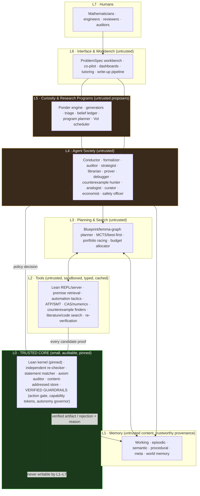
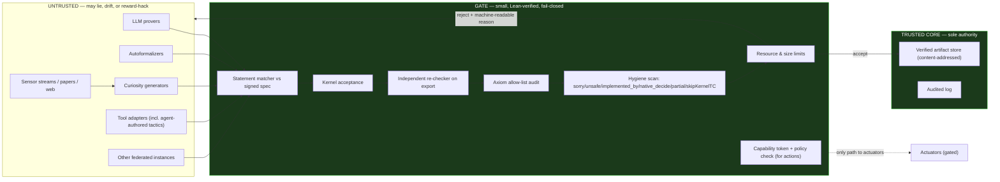
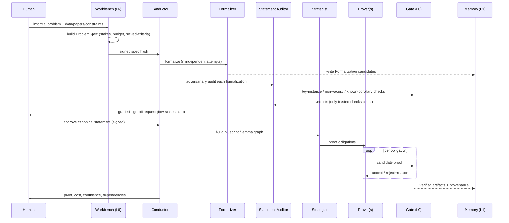
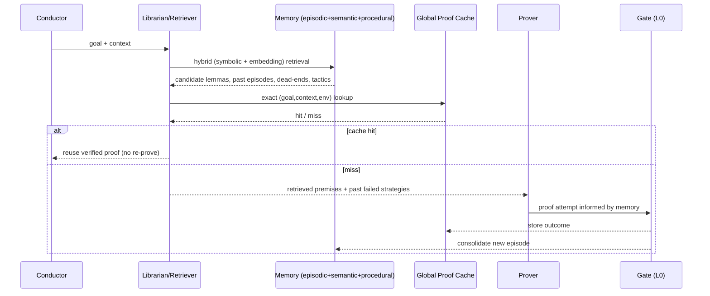
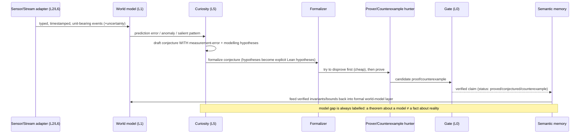

# Phase 2 — Architecture

## 1. Layered view

The system is a **prover-verifier sandwich** with a hard trust boundary. Untrusted proposers
(LLMs, heuristics, search, curiosity) sit above; the trusted core (kernel + independent re-checker +
statement matching + axiom audit + verified guardrails) sits below and is the *only* authority.



**Layer rules (enforced, not stylistic):**

1. Nothing in L1–L7 may write to L0. Provenance records for L0 come from an append-only log owned by L0.
2. Data flows *up* as verified artifacts and structured results with provenance; it flows *down* only
   as untrusted proposals (candidate proofs, formalizations, plans, formalization hypotheses).
3. L5 (curiosity) and L2 (tools) are **read-only** consumers of L1 semantic memory and **read-only**
   consumers of the signed spec; they cannot mutate the problem statement.

## 2. The trusted / untrusted boundary



**Attack surface the gate must defeat** (invariant #1), each with the specific countermeasure:

| Attack | Countermeasure (gate component) |
|---|---|
| `sorry` / `admit` | G5 source scan + kernel "declaration uses sorry" + `#print axioms` |
| Extra axiom (e.g. `axiom foo : P`) | G4 allow-list (`propext`, `Classical.choice`, `Quot.sound` only) |
| `native_decide` / `bv_decide` trust | flagged & policy-gated (needs explicit exception; see A2) |
| `unsafe`, `implemented_by`, `partial` | G5 + kernel flags |
| Kernel bypass (`set_option debug.skipKernelTC true`) | G5 option scan; build with hardened options; re-check on independent kernel (G3) |
| Altered/weakened statement | G1 statement matching against the **signed** spec, canonically normalised |
| Macro / elaborator tricks | re-check on an **independent kernel** from the *exported* proof (G3), not the elaborator |
| Resource exhaustion (DoS by the proposer) | G6 timeout/size/heartbeat limits; sandbox |

## 3. Component inventory

| Component | Layer | Trust | Responsibility | Key interface |
|---|---|---|---|---|
| ProblemSpec workbench | L6 | untrusted | elicit/refine problem; produce `ProblemSpec` | MCP tool `problemspec.*` |
| Conductor | L4 | untrusted | accept work, plan, delegate, budget | A2A task; internal scheduler |
| Formalizer | L4 | untrusted | produce ≥2 independent formalizations + back-translations | MCP `lean.elaborate`, retrieval |
| Statement auditor | L4 | untrusted proposer, but its *check* is verified by the gate | adversarially falsify formalizations (toy instances, non-vacuity) | MCP `lean.check`, counterexample finder |
| Strategist/decomposer | L4 | untrusted | blueprint → lemma graph → obligations | planner API |
| Librarian/retriever | L4 | untrusted | symbolic+embedding premise retrieval | MCP `retrieval.search` |
| Tactic generator / Prover | L4 | untrusted | propose tactics/whole proofs | Lean REPL tool |
| Debugger/repairer | L4 | untrusted | turn Lean diagnostics into repairs | Lean REPL tool |
| Counterexample hunter | L4 | untrusted | attempt disproof first | SAT/SMT/property-testing tools |
| Experimentalist | L4 | untrusted | run certified computation, produce certificates | lab tool belt |
| Analogist | L4 | untrusted | cross-field transfer | semantic memory + literature scout |
| Memory curator | L4 | untrusted | snapshot, index, consolidate, forget | memory API |
| Resource economist | L4 | untrusted | allocate budget, report cost | ledger |
| Safety officer | L4 | untrusted proposer | run dual-use/privacy screens; cannot self-approve | policy tools |
| Meta-agent | L4/L5 | untrusted | design agents/tools/topologies | archive + eval harness (frozen) |
| Lean server / REPL | L2 | untrusted adapter | tactic- and file-level interaction, pinned Mathlib | MCP `lean.*` |
| Retriever | L2 | untrusted | Loogle/LeanSearch-style + embedding hybrid | MCP `retrieval.search` |
| ATP/SMT bridge | L2 | untrusted | external solvers + **proof reconstruction** then kernel re-check | MCP `atp.*` |
| CAS/numerics | L2 | untrusted hint generator | never trusted; outputs become certificates only | MCP `lab.*` |
| **Gate** | L0 | **trusted** | the 7 checks above | `verify(claim, statement, proof, policy) -> Verdict` |
| **Guardrails** | L0 | **trusted, Lean-proven** | action gate, capability tokens, autonomy governor | `authorize(ActionRequest) -> Decision` |
| Content-addressed store | L0 | **trusted** | store/lookup artifacts by hash; append-only audit log | `store.put/get` |
| **Independent re-checker** | L0 | **trusted (external binary)** | replay exported proof on nanoda/con-leche/lean4lean-class kernel | CLI over proof export |

## 4. Protocols

| Boundary | Protocol | Why |
|---|---|---|
| Agent ↔ tools | **MCP** (JSON-RPC; stdio local, Streamable HTTP remote) | Production-stable by 2026; typed tool calls; matches Phase 0 §3 |
| Agent ↔ agent (within an instance) | internal typed message bus with the same envelopes as A2A | One schema, two transports |
| Agent ↔ agent (across instances / "countries") | **A2A v1.0** with **signed Agent Cards** | Cross-org trust; content-hashed artifacts; matches invariant "federated, portable trust" |
| Artifact federation | content-addressed + signature + trust policy | CI-friendly; supply-chain auditable |
| Human ↔ system | workbench + A2A "human" endpoint | Humans are just another peer with higher authority |

**Tool-server interface standard (justified):** *adopt MCP; do not invent.* Rationale (mini decision
record): **Context** — the system needs dozens of typed tools (Lean, retrieval, ATP, CAS) that are
sandboxed, cached, and observable; **Options** — (a) bespoke RPC, (b) MCP, (c) gRPC-only; **Decision**
— MCP as the contract, because it already standardises tool discovery, structured I/O, and
resources, and has a security literature; gRPC only as an internal transport detail behind an MCP
facade; **Consequences** — we inherit MCP's statelessness (good for caching/idempotency) and must
add our own determinism/caching layer (Phase 3 §5.3, §5.19).

## 5. Data model and storage

Everything is a **versioned, content-addressed artifact** (invariant #3). Address =
`H(canonical_bytes)` with a typed namespace prefix.

| Artifact | Address form | Store | Notes |
|---|---|---|---|
| `ProblemSpec` | `spec:<sha256>` | doc store + signed blob | signed by user; agents read-only |
| `Formalization` | `form:<sha256>` | doc store | links to spec hash; multiple per spec |
| `Plan`/Blueprint | `plan:<sha256>` | graph DB | lemma graph, dependencies |
| `SearchNode`/trace | `trace:<sha256>` | event store (append-only) | replayable |
| `ProofCertificate` | `proof:<sha256>` | content store (blob) + index | includes kernel/axIom/version metadata |
| `EpisodeSnapshot` | `ep:<sha256>` | episodic store | case file |
| `Claim`/Belief | `claim:<sha256>` | ledger | status + confidence + deps |
| `ActionRequest` | `act:<sha256>` | audit log | policy decision recorded |
| Lean env | `env:<lean-version+mathlib-hash>` | env registry | all proofs reference their env |

**Storage tiers:**
- **Content store:** on-disk CAS (like git objects) + object storage for bulk blobs.
- **Index/vector store:** embedding index for semantic retrieval; separate **symbolic** index
  (Loogle-style type/pattern) — hybrid retrieval, not one or the other.
- **Event log:** append-only, per L0 audit; replayable (flight recorder, §5.20).
- **Global proof cache:** keyed by `(goal-normal-form-hash, context-hash, env-hash)` → outcome
  (proved / disproved / timed-out) — the single highest-leverage cost reducer (§5.19).

## 6. Deployment topologies


| Scale | What changes | What breaks first |
|---|---|---|
| 10⁰ | everything local, single process | retrieval quality |
| 10¹–10³ | add subagent pool, cache, real stores | verifier throughput |
| 10³–10⁶ | gate becomes a **farm**; agents become ephemeral & stateless | coordination overhead, cache contention |
| 10⁶–10⁹ | instances federate; **no single kernel**; trust is by policy | proof-dependency structure & duplicate work (must dedup) |

## 7. Sequence diagrams (the eight required flows)

### A. A new problem, end to end



### B. Memory-augmented reuse of an earlier episode



### C. Sensor → conjecture → proof → knowledge



### D. The curiosity loop

```mermaid
sequenceDiagram
  participant CO as Conductor/Economist
  participant CU as Ponder engine (drives)
  participant GN as Generators
  participant TR as Triage
  participant PR as Prover/Hunter
  participant GT as Gate (L0)
  participant ME as Memory + archive
  CO->>CU: budget slice
  CU->>GN: propose seed ideas (drives: compression, novelty, unification, bridging)
  GN-->>TR: candidate conjectures/definitions
  TR->>TR: novelty vs library; triviality via automation; cheap disproof; significance/cost; safety screen
  TR->>PR: survivors (explore/exploit portfolio)
  PR->>GT: proof or counterexample
  GT-->>ME: verified outcome
  ME->>CU: update belief ledger + QD archive + drives
  CU-->>CO: report cost, novelty, later-usefulness
```

### E. Failure and recovery

```mermaid
sequenceDiagram
  participant CO as Conductor
  participant PR as Prover
  participant GT as Gate (L0)
  participant RC as Independent re-checker
  participant ME as Memory (dead-ends)
  participant RM as Resource monitor
  PR->>GT: candidate proof (claims success)
  GT->>GT: hygiene scan + axiom audit + statement match
  alt hygiene/axiom/statement fail
    GT-->>PR: reject (machine-readable reason); log exploit attempt
    PR->>ME: record dead-end + why
  else gate passes
    GT->>RC: export proof → independent kernel
    alt re-checker rejects
      GT-->>CO: FALSE ACCEPT ALERT (kernel/version mismatch); quarantine artifact; freeze env
      CO->>RM: escalate; require human review; do not update memory as "verified"
    else re-checker accepts
      GT-->>ME: verified artifact
    end
  end
  RM-->>CO: heartbeat/timeout/budget breach → cancel, checkpoint, resume later
```

### F. Scale-out from 10³ to 10⁹ agents

```mermaid
sequenceDiagram
  participant SCH as Scheduler + back-pressure
  participant DED as Goal-hash dedup
  participant SW as Swarm (ephemeral agents)
  participant GTF as Gate farm
  participant PC as Global proof cache
  participant FED as Federation
  SCH->>DED: incoming obligations
  DED->>DED: canonical goal hash; drop duplicates; canonicalise
  DED->>SW: distribute unique work (speculative + portfolio)
  SW->>PC: check cache first
  SW->>GTF: submit candidates
  GTF->>PC: store outcomes
  Note over SCH,FED: verifier throughput is the wall; scale gates before agents
  GTF->>FED: publish verified artifacts (by policy)
  FED-->>SCH: cross-instance cache hits reduce work
```

### G. A literature audit (find the gap)

```mermaid
sequenceDiagram
  participant LS as Literature scout
  participant RD as Reading pipeline
  participant BL as Blueprint builder
  participant FO as Formalizer
  participant PR as Prover/Hunter
  participant GT as Gate (L0)
  participant ME as Memory
  participant U as Human
  LS->>RD: ingest paper/book/preprint + code
  RD->>BL: extract definitions, claims, dependency graph, proof sketch
  BL->>FO: formalize incrementally
  FO->>PR: prove each step; if a step fails, hunt for the missing hypothesis or a counterexample
  PR->>GT: gap lemma / counterexample / repaired step
  GT-->>ME: verified gap report
  ME->>U: referee-style report with machine-checked evidence
```

### H. A months-long research campaign

```mermaid
sequenceDiagram
  participant U as Human (PI)
  participant PP as Program planner
  participant BL as Belief ledger
  participant VOI as Value-of-information scheduler
  participant SW as Agent society
  participant GT as Gate (L0)
  participant ME as Memory
  U->>PP: grand question; milestones; pivot/kill criteria
  loop weeks→years (checkpoint & resume across restarts)
    PP->>VOI: current beliefs + tractability + value
    VOI->>SW: allocate compute across concurrent problems (stop-loss rules)
    SW->>GT: results (partial, full, counterexample)
    GT-->>BL: update calibrated probabilities
    BL->>PP: rebalance agenda; surface partial wins (special cases, reductions)
    PP->>U: collaboration hand-offs, blueprint dashboards, review queue
  end
```

## 8. Schemas (overview; full definitions in Phase 3)

Core artifacts: `ProblemSpec`, `Claim`, `ProofCertificate`, `EpisodeSnapshot`, `ActionRequest`.
Each is given as **both** JSON Schema and a Lean `structure` sketch in
[phase-3-deep-dives.md](phase-3-deep-dives.md#8-schemas). The gate's `Verdict` and the guardrails'
`Decision` are Lean-defined and belong to the trusted core.

## 9. Mini decision records

**D2.1 — Where does orchestration live?**
*Context:* the gate must be trusted; control flow is complex.
*Options:* (a) all-Lean; (b) all-external; (c) external control flow + Lean-verified gate/guardrails.
*Decision:* **(c)**. *Consequences:* we get proved safety invariants where they matter and keep
orchestration maintainable; we must define a small, stable Lean↔runtime interface.

**D2.2 — One store or many?**
*Context:* need provenance, retrieval, replay.
*Options:* (a) a single relational DB; (b) content-addressed CAS + specialised indexes; (c) bespoke.
*Decision:* **(b)**. *Consequences:* natural dedup & federation by hash; we must build indexing on top.

**D2.3 — Adopt MCP/A2A or bespoke?**
*Decision:* **adopt MCP + A2A** (Phase 0 §3). *Consequences:* inherit their security models and
must harden the known protocol risks (identity binding, wrong-provider tool execution).

## Self-critique (Phase 2)

- **Weakest assumption:** that an independent-kernel re-check of *every* proof is affordable. If not,
  we must sample (risk: a false-accept slips through). Mitigation: re-check *all* high-stakes proofs;
  sample low-stakes ones; always re-check anything touching the shared library. Flagged.
- **Unresolved:** the exact canonical form for goal hashing (must be stable across env versions or
  the cache leaks across envs). Treated as a Phase 3 research question.
- **Risk:** federation (§9/H) multiplies the attack surface; we gate it behind v4 and strict policy.
- **Falsifier for D2.3:** if MCP's statelessness forces expensive re-derivation per call in a way
  gRPC-with-session would avoid, we revisit — measured as overhead per proof step (Phase 5).
