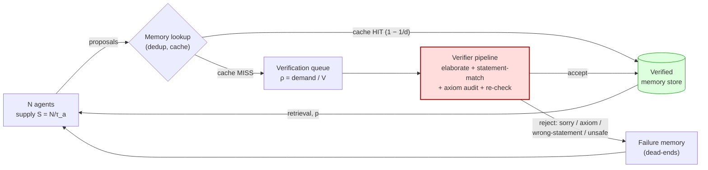

# Phase 5 — Scale & Economics: How Far "More Agents" Actually Gets You

> Design-team phase 5 of the Master Prompt brief. Phase-1 defaults P3 (8-GPU node → 1,000+ GPUs,
> ~US$50k/month) and P4 (small team) are fixed inputs here. Status tags:
> `[exists today]` / `[near-term]` / `[frontier]` / `[speculative]`.

## 0. Purpose and the bet this phase is testing

The brief (§5.9, §5.11, §5.12) asks us to take the premise **"more agents ⇒ more theorems"** seriously
and find where it breaks. Phase 1 (Q3) recorded our strong prior:

> **Bet B1.** The binding constraint is **not** agent count. It is the *verifier pipeline* (elaborate →
> statement-match → axiom audit → independent re-check) plus *memory* (caching, dedup, retrieval).
> Agents are cheap and elastic; verified truth is expensive and serialish.

This phase makes that bet quantitative, states the falsifying experiment for it, and produces the
investment order. It also defines the four numbers we will actually instrument (§8): **demand rate,
verifier capacity, dedup factor, and retrieval precision.**

**Honesty note.** All numbers below are *back-of-envelope* with explicit assumptions, not measured on
our system (it does not exist yet). They are given as ranges so that a factor-of-2 error does not
invalidate the conclusion. Every assumption is tagged so it can be replaced by a measurement.

---

## 1. The capacity model

### 1.1 Symbols

| Symbol | Meaning | Default assumption (flagged) |
|---|---|---|
| `τ_a` | Mean agent latency for **one proposal** (LLM call + tool calls + retrieval) | **10–60 s** (frontier model, multi-turn) |
| `h` | Acceptance rate: fraction of proposals that are well-formed, on-statement, and kernel-accepted without cheating | **0.02–0.20** for whole-proof attempts; higher for single tactics/subgoals (0.1–0.4) |
| `τ_v` | Mean latency of **one full verification pass**: elaborate + statement-match + axiom audit + independent re-check | **2–10 s** (warm Mathlib context, nontrivial lemma) |
| `c_v` | Elaboration cores per verifier pipeline (parallel front-end, serial kernel) | **8** (one 8-GPU node can host several pipelines) |
| `d` | **Dedup factor**: raw proposals ÷ *unique, verifier-worthy* obligations (after memory lookup) | **1–10** at 10⁰–10³; **10²–10³** at 10⁶+ if memory works |
| `p` | Retrieval precision: fraction of retrieved premises/lemmas that are actually relevant | **0.3–0.8** (LeanSearch/Mathlib-class retrieval `[near-term]`) |
| `N` | Live agents (concurrent proposers) | ladder variable |
| `b` | Effective branching factor of the reachable subgoal DAG for a single problem | **3–10** |
| `X_use` | **Useful** verified-lemma rate (net-new, deduplicated) | derived |

### 1.2 The two rates

- **Proposal supply:** `S = N / τ_a` proposals per second.
- **Verifier capacity:** `V = (#pipelines) / τ_v` verification passes per second. A pipeline is
  `c_v` cores; kernels within a pipeline are effectively serial over a warm environment.
- **Effective verified rate** (with dedup `d` and hit-rate `h`):

```
X_gross = min( S · h ,  V )              # what the system can actually complete
X_use   = X_gross · (1 / d_effective)    # net-new knowledge written to memory
```

Read this as: agents supply proposals, the verifier caps completions, memory divides the *cost per
net-new lemma* by re-using everything already known.

### 1.3 Little's Law gives the required fleet

For a target useful rate `X_use` and independent subgoals:

```
agents_needed    ≈ X_gross · τ_a / h        # in-flight proposals
pipelines_needed ≈ X_gross · τ_v            # verifier supply
```

The **outer** scaler is the verifier term; it has no `h` in it and therefore does **not** benefit from
better agents — only from cheaper verification, better caching (smaller `X_gross` for the same
`X_use`), or more pipelines.



The red box is the trusted core. The green store is the only thing that *compounds*. Everything else
scales linearly with money.

---

## 2. The scale ladder (10⁰ → 10⁹ agents)

Throughput assumes `τ_a = 30 s`, `h = 0.10` (mid-range), `τ_v = 5 s`, `c_v = 8`; ranges reflect the
flagged uncertainty. "Net-new/day" applies `d_effective` from the next column.

### 10⁰ — one agent, one human (MVP target)

| Quantity | Value |
|---|---|
| Proposers | 1 (plus a human) |
| Proposal rate `S` | 0.033 /s |
| Gross verified rate | ~0.003 /s → **~280/day** *theoretical*; realistic human-attended output **1–20 meaningful lemmas/day** |
| Verifier pipelines | 1 (same workstation) |
| Dedup `d` | 1–2 |
| Bottleneck | Human attention + formalization/statement authoring, **not** compute |
| Tag | `[exists today]` (LeanDojo / LeanCopilot / REPL-agent class) |

**Takeaway:** at 10⁰ the binding constraint is *fidelity* (is the statement even right?), which is why
Phase 1 ranks Q1 highest.

### 10³ — a node-scale swarm of specialist agents (`[near-term]`)

| Quantity | Value |
|---|---|
| Proposers `N` | 1,000 |
| Proposal rate `S` | ~33 /s |
| Gross verified | `min(33·0.1, V)`; with 8 pipelines `V ≈ 1.6 /s` → **verifier-bound at ~1.6 /s** (≈ $140k/day ceiling if sustained) |
| Pipelines needed | ~8 (one 8-GPU node: 8 pipelines × 8 cores = 64 GPUs → *two* nodes, or accept fewer pipelines) |
| Dedup `d` | 2–10 (repo-scale cache) |
| Net-new/day | ~15k–70k *subgoal-level* results; far fewer whole theorems |
| New risk | **Queueing**: `ρ = demand / V ≈ 2–20` → delays grow, retries duplicate work |
| Bottleneck | **Verifier throughput** + cache hit-rate. Agents are *already* oversupplied. |

**Takeaway:** the crossover to "agents no longer matter" happens *before* 10³. As soon as `S·h > V`,
adding agents adds queue, not throughput.

### 10⁶ — fleet scale (portfolio of many problems) (`[frontier]`)

| Quantity | Value |
|---|---|
| Proposers `N` | 10⁶ |
| Proposal rate `S` | ~33k /s |
| Gross verified (uncapped) | ~3,300 /s → would need **~16,500 pipelines** (~132k GPUs) ⇒ economically absurd → *must* collapse demand with memory |
| With dedup `d ≈ 10³` | effective demand ~3.3 /s → **~330 pipelines** (≈ 2,600 GPUs) — the only viable regime |
| Pipelines | 300–3,000 |
| New risk | **Retrieval quality** and **index QPS** become co-bottlenecks; coordination/curation cost grows; `p` drops under load |
| Tag | `[frontier]`; full 10⁶ sustained is `[speculative]` |

**Takeaway:** at 10⁶ the system is a *portfolio manager*, not a single prover. Value comes from
(b) running many problems concurrently and (c) a very high dedup factor — **not** from 10⁶ agents on
one theorem.

### 10⁹ — "country-scale society of billions of agents" (brief §2 limit) (`[speculative]`)

| Quantity | Value |
|---|---|
| Proposers `N` | 10⁹ |
| Proposal rate `S` | ~3.3×10⁷ /s |
| Gross verified demand | ~3.3×10⁶ /s uncapped |
| Physical reality | Even at 100 verified/s per machine, this needs ~33,000 machines; the *useful* rate is capped long before that |
| Real ceiling | The **reachable frontier of the proof/subgoal DAG** — a finite, database-bounded set — plus **energy** (§6). Beyond it, agents re-derive known results. |
| What it is really good for | Massive *embarrassingly-parallel* enumeration (e.g. conjecture generation, lemma-mining, counterexample search) — **not** deep single-theorem search |
| Tag | `[speculative]`; we do **not** plan for it, we *bound* it |

**Takeaway:** 10⁹ is a statement about *generation* (ideas, candidate lemmas, counterexamples), not
about *verification or depth*. The brief's phrase is best read as "a society that can *originate*
enormous breadth under a verification ceiling". The design's scale-free property (Phase 2, diagram F)
is what makes 10⁹ *statable*; the verifier ceiling is what makes it *honest*.

### Ladder summary

| Scale | Dominant constraint | What to add to help | What adding hurts |
|---|---|---|---|
| 10⁰ | Human fidelity/attention | Better formalizer + statement audit | — |
| 10³ | Verifier throughput `V`, dedup `d` | Pipelines, cache, parallel kernels | More agents (queue) |
| 10⁶ | Retrieval `p`, index QPS, curation | Retrieval, dedup, portfolio scheduling | More agents (noise, cost) |
| 10⁹ | Reachable frontier + energy | Breadth generators, cheap proposal filters (untrusted) | Everything (energy, Goodhart) |

---

## 3. Bottleneck analysis (the four named bottlenecks)

### 3.1 Proof dependency structure `[exists today]`

Proof search is a DAG, not an embarrassingly-parallel workload. Amdahl for a single theorem:

```
speedup ≤ 1 / ( s_serial + (1 − s_serial)/b_eff )
```

where `s_serial` is the unavoidable serial fraction (statement authoring, final assembly, the top-level
argument) and `b_eff` is the usable parallel width (roughly the branching factor `b`). With `b ≈ 3–10`
and `s_serial ≈ 0.3`, the **single-theorem speedup ceiling is ~2–3×**, regardless of N. Conclusion:
**concurrency buys breadth, not depth.** Depth comes from better single-agent reasoning + reuse (§5).

### 3.2 Coordination overhead `[near-term]`

- Hub topology: message/curation cost `O(N)`; hierarchy: `O(N log N)`. Both are affordable.
- Token/electricity cost is **linear in N**; *useful* throughput saturates at `V`. Therefore
  **cost per useful result is convex**: it decreases with N until `S·h = V`, then rises.
- The real overhead is **duplicate work**: without dedup, N agents rediscover the same lemma. Cache
  hit-rate is the single most important economic variable, which is why memory is invariant #3.

### 3.3 Verifier throughput `[exists today]` (the primary bottleneck)

Verification is *serialized by truth*: a warm environment's kernel checks one proof. Supply levers:

1. **Reduce demand** — memory/dedup/caching (cheapest; effective multiplier = `d`).
2. **Increase supply** — more pipelines, plus **independent re-checkers on separate hardware**
   (nanoda/con-leche/lean4lean-class) so re-checking does not steal cores from elaboration.
3. **Untrusted pre-filters** — surrogate models that *reject* obviously-bad proposals cheaply.
   They may **never accept**; they only reduce load. (This preserves invariant #1: the kernel is the
   sole authority.)
4. **Parallel proof checking** — Lean's elaborator parallelizes across independent declarations
   `[exists today]`; the kernel step for a given declaration is still serial `[near-term]` to improve.

### 3.4 Retrieval quality `[near-term]`

Retrieval precision `p` multiplies `h`: bad premises ⇒ off-statement or non-compiling proposals ⇒
wasted verifier cycles. Retrieval quality is therefore a **global efficiency multiplier**, not a
feature. Phase 3 §5.5/§5.14 own this; Phase 8 ranks it #3 for investment.

---

## 4. Where more agents stop helping (the explicit answer)

**Answer:** *well before 10³ agents on a single problem, and the ceiling is set by the verifier, the
dedup factor, and the proof-DAG width — not by agent count.*

Three independent saturation mechanisms:

1. **Verifier saturation.** Once `S·h > V`, extra agents only lengthen the queue (`ρ > 1`). The
   marginal agent's contribution → 0.
2. **Dedup saturation.** Once the reachable subgoal space is well-covered, novel-proposal rate per new
   agent decays geometrically (`d` rises). The marginal agent re-derives known facts.
3. **DAG-width saturation (§3.1).** Single-theorem parallel speedup ceiling ≈ `b` (`~2–3×` with
   `s_serial`). Adding agents past the frontier width is pure cost.

Corollary (the design's actual scaling thesis):

> **Scale breadth, not depth.** Let `N` grow across *problems, conjecture classes, and
> lemma-mining tasks*; keep *per-theorem* concurrency at ~10–100. Depth comes from memory reuse +
> better reasoning, which are super-linear in value per unit compute.

---

## 5. Cost per verified lemma

### 5.1 Unit decomposition

```
cost / net-new verified lemma
  = ( N/τ_a · τ_a · c_model )        # model cost of ALL proposals (d/h amplify this)
      / ( X_use )                    # ÷ net-new verified per unit time
    / (acceptance & dedup)           # = 1/(h · d) roughly
  + τ_v · c_v · c_gpu                # verification compute per PASS
  + c_retrieval + c_curation         # retrieval calls + memory curation ("sleep")
```

### 5.2 Back-of-envelope table (model cost only, frontier pricing as flagged assumption)

Assumed per-proposal model cost `c_model` ∈ **$0.002–$0.05**; verification/cpu/retrieval overhead
≈ **$0.01–$0.10** per pass; curation overhead ≈ **1–2×** the verified-lemma cost.

| Regime | `h` | `d` | Rough cost / **small** verified lemma | Rough cost / **net-new** lemma |
|---|---|---|---|---|
| 10⁰ (human-attended, on-distribution) | 0.20 | 1 | ~$0.05–$1 | ~$0.1–$2 |
| 10³ (swarm, verifier-bound) | 0.10 | 5 | ~$0.2–$3 | ~$1–$10 |
| 10⁶ (churn-dominated, saturated dedup) | 0.03 | 1000 | — | **$5–$50+** (most compute re-derives known) |
| 10⁹ | — | saturated | — | **economically irrational for depth**; only pays for *breadth at the frontier* |

**Interpretation:** cost per *net-new* lemma is **U-shaped in N** — it *falls* while `S·h < V` (more
agents ⇒ more hits) and *rises* once saturated (more agents ⇒ more re-derivation, more curation). The
minimum is near the crossover `S·h ≈ V`. **The optimal swarm size is not the largest swarm size.**

### 5.3 What actually lowers cost (ranked by leverage)

1. **Dedup/cache** — the largest multiplier; can cut demand 10²–10³× (≈ "free" verifier supply).
2. **Independent re-check offload** — keeps kernels from stealing elaboration cores.
3. **Better `h`** via retrieval + RL'd specialist provers — linear in every downstream quantity.
4. **Bigger `V`** via more pipelines — linear, expensive, honest.
5. **More agents** — last; only helps *breadth* while unsaturated.

---

## 6. Energy

- Assumed power: **0.3–0.7 kW per 8-GPU node under load** (flagged assumption).
- 10³-scale (≈ 2 nodes, verifier-bound, mostly idle-steered): **≈ 0.6–1.4 kWh/h → ~15–35 kWh/day**.
- 10⁶-scale (≈ 300–3,000 pipelines ⇒ ≈ 2,400–24,000 GPUs ⇒ ~300–3,000 nodes):
  **≈ 90–2,100 kWh/h → 2–50 MWh/day** (≈ 0.7–18 GWh/year).
- **Energy per verified lemma** = total node-energy ÷ `X_use`. This *rises* once dedup saturates
  (same reason cost rises), so energy efficiency is governed by the *same* levers as §5.

**Design consequence:** because verification is the useful work, an efficient system spends energy on
*checking fewer, better proposals* rather than on *generating more proposals*. A cheap untrusted
pre-filter that eliminates 90 % of doomed proposals cuts energy more than any swarm-size choice.

---

## 7. Investment order (what to buy first)

| Rank | Investment | Why first | Expected effect | Tag |
|---|---|---|---|---|
| 1 | **Verifier throughput + independent re-check harness** | It is both the *correctness* core and the *supply* cap | Unlocks all throughput; removes the queue | `[exists today]` |
| 2 | **Memory: dedup/cache + content-addressed artifacts** | Highest ROI; divides demand by `d` | Near-linear effective throughput for ~free | `[near-term]` |
| 3 | **Retrieval quality `p`** | Global multiplier on `h` | Cuts wasted verifier cycles | `[near-term]` |
| 4 | **Better single-agent reasoning (RL flywheel, §5.18)** | Raises `h` without adding N | Depth, exactly where swarms cannot help | `[frontier]` |
| 5 | **Curriculum / curation ("sleep", §5.13)** | Compounds; prevents memory rot | Sustains `d` and `p` over months | `[frontier]` |
| 6 | **Agent count / swarm orchestration** | Only breadth, only while unsaturated | Marginal | `[near-term]` |

This is *exactly* Phase 1's Q3 bet (verification/memory first, agents last) made operational, and it
flows directly into Phase 6's roadmap order and Phase 8's "what to build first".

---

## 8. Decision records and falsifying experiments

### DR 5.1 — "Scale breadth, not depth"

- **Context:** brief §5.11/§5.12 asks for swarms up to 10⁹; the proof DAG caps single-theorem speedup.
- **Options:** (a) maximize per-theorem concurrency; (b) cap per-theorem concurrency and scale across
  problems; (c) ignore the distinction.
- **Decision:** **(b)**. Per-theorem live agents ≈ 10–100; scale `N` across a problem portfolio.
- **Consequences:** orchestrator is a *portfolio scheduler* above a *bounded per-problem swarm*
  (Phase 2, diagram F; Phase 3 §5.11).
- **Falsifying experiment:** run one PutnamBench problem with N = 10, 100, 1000 agents (fixed verifier
  budget) and measure solved-time and cost/lemma. **If** time-to-solve keeps improving past N ≈ 100
  at constant verifier budget, B1/DR 5.1 are wrong and we re-weight toward swarms.

### DR 5.2 — Verifier-first supply

- **Context:** `V` has no `h`, so it does not improve with better agents.
- **Decision:** invest in inference-supply (pipelines + independent kernels + pre-filters) **before**
  agent count; treat surrogate verifiers as *reject-only* to preserve invariant #1.
- **Falsifying experiment:** measure `ρ` (queue utilization) and cache hit-rate under increasing N at
  fixed pipelines. **If** `ρ < 1` and cost/lemma keeps *falling* with N, the bottleneck is elsewhere
  (likely retrieval/fidelity), and we re-allocate from pipelines to retrieval.

### DR 5.3 — Report two currencies only

- **Decision:** always report **US$/verified theorem** and **GPU-seconds/verified lemma** (Phase 1 A4).
- **Consequences:** no incomparable "×cost" claims; enables portfolio-level budget caps (P3 ≈ $50k/mo).
- **Falsifying experiment:** if the two currencies rank two candidate strategies *differently*,
  investigate the divergence (usually a cache/energy mismatch); do not average them away.

### Instrumentation plan (measures the four numbers in §0)

1. **Demand rate** — proposals/s by type (whole-proof, subgoal, tactic, conjecture).
2. **Verifier capacity** — passes/s and mean `τ_v` per pass stage; per-pipeline utilization `ρ`.
3. **Dedup factor** — cache hit-rate; unique obligations ÷ raw proposals.
4. **Retrieval precision** — sampled human/verified relevance judgments per retrieval batch.
Plus: **cost/verified theorem**, **GPU-seconds/lemma**, **dead-end register hit-rate** (are we
re-surfacing known failures?), and **energy/verified lemma**.

These are the first dashboards built in the MVP (Phase 6) so the bet is *falsifiable within weeks*,
not months.

---

## 9. Self-critique (Phase 5)

- **Weakest assumption:** `h` and `d` ranges. They are the two numbers the whole economics tilts on,
  and we have no data yet. Fix: §8 instrumentation ships in the MVP precisely to replace guesses with
  measurements; §5 numbers are ranges for this reason.
- **What was fixed:** the "more agents" premise is now *quantitatively* bounded (saturation at
  `S·h > V`), not hand-waved; the 10⁹ scale is reframed as *breadth under a verification ceiling*.
- **What remains flagged:** `c_model` pricing, node power draw, and `b_eff` for Mathlib-scale DAGs are
  all assumed; the Q3 bet (verification-first) could still be wrong if fidelity/formalization (Q1)
  dominates cost — Phase 6's 90-day demo is designed to surface that early.
- **Honesty:** no number here is measured on our system; the plan does not depend on any single number
  being right, only on the *shape* (verifier cap, dedup multiplier, U-shaped net-new cost), which is
  robust across the stated ranges.
