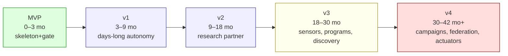

# Phase 6 — Roadmap: MVP → v1 → v2 → v3 → v4

> Design-team phase 6 of the Master Prompt brief. Consumes Phase 1 defaults (P3 budget, P4 team/timeline,
> P10 "all packs"), Phase 5's investment order, and places **every** capability pack §5.10–§5.22 on the
> timeline with an argued deferral where applicable. Status tags:
> `[exists today]` / `[near-term]` / `[frontier]` / `[speculative]`.

## 0. Sequencing principle

Phase 5 fixed the investment order: **verifier → memory → retrieval → reasoning → curation → agents**.
The roadmap is that order unrolled in time, with the *fidelity-first* discipline chosen in Phase 1 (Q1):
a proof only counts when the **statement is right** and an **independent kernel re-checks it**.

Guiding rule: **each stage must be falsifiable by an experiment it can afford.** We never advance a
stage whose core bet we have not tried to break.

---

## 1. MVP (months 0–3) — "one problem, honestly proved"

**Goal:** convince ourselves (and a skeptic) that the trusted core + memory loop works end-to-end on
real Mathlib problems, with dashboards that measure Phase 5's four numbers.

| Aspect | Scope |
|---|---|
| **Packs** | §5.1 (intake, text-only), §5.2 (basic planner), §5.3 (Lean REPL + Mathlib tools), §5.5 (working/episodic/procedural memory v0), §5.8 (verifier gate + axiom audit + independent re-check), §5.20 (logging/observability), tickle of §5.9 (human gate for definition admission) |
| **Deliverables** | Phase 9 walking skeleton (`/skeleton`); VerifierGate rejecting `sorry`/`native_decide`/`unsafe`/`implemented_by`/`partial`/`skipKernelTC`/wrong-statement/extra-axiom; content-addressed JSONL memory; propose→verify→record loop; **instrumentation** for demand/`V`/`d`/`p` |
| **Compute** | 1 workstation (P3) |
| **Staffing** | 1 Lean/Mathlib expert + 1 engineer + fractional safety reviewer |
| **Exit criteria** | (E1) ≥ 3 nontrivial Mathlib lemmas proved and *independently re-checked* on a pinned toolchain; (E2) every adversarial test rejected and the honest case accepted; (E3) dashboards report all four Phase 5 numbers; (E4) a statement-mismatch attack fails |
| **Risks** | Toolchain pinning/Mathlib churn; statement-matching is subtler than it looks; independent re-checker availability |
| **Kill criteria** | If the trusted gate cannot be made to reject *every* known cheat class in red-team (§Phase 7) within the window, **stop and fix the gate** before any scale work — no exceptions (invariant #1) |
| **Tag** | `[exists today]` components; integration is `[near-term]` |

## 2. v1 (months 3–9) — "days-long autonomous proving"

**Goal:** raise the pipeline to Phase-5's 10³ regime **without adding agents first** (DR 5.1/5.2).

| Aspect | Scope |
|---|---|
| **Packs** | Full §5.1 (papers/data → Lean), §5.2 (VoI planner + portfolio scheduler), §5.3 (curated tool suite, retrieval via LeanSearch-class), §5.4 **bounded** per-problem swarm (10–100), §5.5 (semantic memory + consolidation "sleep", §5.13 seed), §5.6 (read-only sensor *stub*, no actuators), §5.8 (multi-kernel re-check, statement signing), §5.9 (full gate logic), §5.20 (reliability/QA) |
| **Scale** | 10³ *proposals* across a **portfolio**; per-theorem concurrency capped (DR 5.1) |
| **Compute** | 1–2 8-GPU nodes (P3, ≤$50k/mo) |
| **Staffing** | 4 engineers + 1 Lean expert (+ fractional safety) (P4) |
| **Exit criteria** | (E1) a **days-long unattended run** with checkpoint/restart (§5.10 seed) that solves ≥ 1 PutnamBench-class problem and reaches a *verified* partial result on a research-scale target; (E2) measured **cost/verified theorem** and **GPU-s/lemma** meet a stated budget; (E3) no cheat class from Phase 7 succeeds in a fresh red-team pass |
| **Risks** | Queue saturation (`ρ>1`) if pipelines not scaled; memory rot (`d`, `p` decay) without curation; fidelity failures on paper→Lean intake |
| **Kill criteria** | If after 9 months the **independent re-check pass-rate** is not ≥ 95 % of compiled results, the "verified" claim is not credible — **pause feature work and re-harden the gate** |

## 3. v2 (months 9–18) — "long-horizon research partner"

**Goal:** months-scale *planning*, literature auditing, and certified computation — the brief's
"research partner" mission — on top of a proven gate.

| Aspect | Scope |
|---|---|
| **Packs** | §5.10 **full** belief ledger + months-long campaigns; §5.11 experimentation lab + **certified computation** (`[near-term]`); §5.12 literature-to-Lean + auditing; §5.13 generalization/abstraction/library gardening (definition admission behind human gate); §5.14 multimodal/structured intake; §5.17 discovery **staged on**, evaluator-bounded; §5.18 self-improvement flywheel (RL on specialist provers, P6) |
| **Scale** | 10³–10⁴ agents; portfolio grows; curation budget becomes a first-class line item |
| **Compute** | 2–8 nodes, cloud burst begins |
| **Staffing** | 4 engineers + 1 Lean expert + 1 research/reasoning lead (+ safety) |
| **Exit criteria** | (E1) a **month-long campaign** produces ≥ 1 genuinely new (not-in-Mathlib) verified lemma and a human-readable write-up; (E2) a **literature audit** finds a missing hypothesis, with a *verified counterexample*, in a real paper; (E3) belief ledger survives restart mid-campaign; (E4) evaluator frozen (Phase 1 A3) with no leakage |
| **Risks** | Goodhart on discovery metrics; library-extension under-specification; RL flywheel poisoning; federation temptations arriving too early |
| **Kill criteria** | If **library gardening** cannot keep `p` (retrieval precision) from decaying over a 30-day run, freeze definition admission and re-invest in §5.13 before scaling further |

## 4. v3 (months 18–30) — "world interface, programs, discovery"

**Goal:** add the risky capabilities only after trust is proven — read-only sensing, program/protocol
verification, and open-ended discovery.

| Aspect | Scope |
|---|---|
| **Packs** | §5.6 **read-only sensors → world models** (predictive, labelled as models, no actuators); §5.15 program/protocol/system verification; §5.16 domain packs + plug-in architecture; §5.17 **open-ended discovery** at frontier; §5.19 adaptive compute + verification infrastructure; §5.21 federation/provenance/governance (first inter-instance exchange of *verified* artifacts only) |
| **Scale** | 10⁴–10⁶ agents across a portfolio (`[frontier]`); high dedup regime (Phase 5 §2) |
| **Compute** | Cloud burst to ≥ 1,000 GPUs (P3) |
| **Staffing** | +1 distributed-systems engineer, +1 verification-for-code specialist, + safety engineer ≥ 1 FTE |
| **Exit criteria** | (E1) a **control-law stability result** would have exposed the model gap (§5.6-b latent, Phase 4 example) with the Safety Officer refusing a real-world safety claim without human sign-off; (E2) a program/protocol verification case study passes independent re-check; (E3) federation exchange of a verified artifact **cannot** weaken the receiving core (adversarial federation test fails to inject an axiom) |
| **Risks** | Perception→Lean bridge mis-calibration (measurement-error hypotheses omitted); federation supply-chain attacks; discovery producing "interesting" but unverifiable claims (must be quarantined) |
| **Kill criteria** | If a **federation can inject an unverified or extra-axiom artifact** into a peer's trusted core in red-team, **cut §5.21 to verified-only pull with human sign-off** until fixed |

## 5. v4 (months 30–42+) — "campaigns, federation, gated actuation"

**Goal:** the full brief §2 mission, with actuators only behind strict human gates.

| Aspect | Scope |
|---|---|
| **Packs** | §5.6 **simulated actuators → real actuators with human approval** (P7); §5.17 discovery "beyond human priors" (`[speculative]`, evaluator-bounded); §5.18 self-designing agents/tools (with frozen evaluator, A3); §5.21 full federation + incentives; §5.22 human collaboration/teaching at scale |
| **Scale** | Portfolio at 10⁶+; 10⁹ only as *breadth generators*, never for depth (Phase 5 §4) |
| **Compute** | Multi-site; national-scale burst possible but **cost-capped** by DR 5.3 currencies |
| **Exit criteria** | (E1) a real-world interface operates **only** with human approval and a printed model-gap accounting; (E2) self-improvement improves a *frozen* benchmark without touching the trusted core (falsifiable per A3); (E3) a federation of ≥ 2 instances shares verified knowledge with provenance and no core weakening |
| **Risks** | Irreversibility of real actuators; self-improvement Goodharting; federation incentive gaming; regulatory/export-control (P9) |
| **Kill criteria** | If any real actuator action cannot be shown reversible or human-gated in all paths, **disable actuators** (invariant #8) — the system continues as a research partner without them |
| **Tag** | Mostly `[frontier]`–`[speculative]` |

---

## 6. The 90-day demo that convinces a skeptic

**Hypothesis to test (Phase 5 bet B1):** *at fixed verifier budget, more agents stop helping past ~10²
per problem, while memory/verification form the real bottleneck.*

**Demo script (MVP exit, defendable on one workstation):**

1. **Trust demo.** Show the gate rejecting, live: a `sorry` proof, an `extra-axiom` proof, a
   `native_decide` proof, an `unsafe`/`implemented_by` proof, a **wrong-statement** proof, and a
   `skipKernelTC` proof — then accepting one honest proof that an **independent kernel re-checks**.
   This is the "LLM proposes, kernel disposes" invariant made visible.
2. **Fidelity demo.** Take a short statement from a real paper, show a *deliberately sloppy*
   formalization being caught by the statement auditor (missing hypothesis), then the corrected one
   proved. (Ties to Phase 1 Q1.)
3. **Economics demo.** Run the **same** PutnamBench-class problem with N = 10, 100, 1000 agents at a
   **fixed verifier budget** and plot solved-time and cost/lemma. Show the **knee** predicted by
   DR 5.1, or openly report that it did not appear (falsification is a valid outcome).
4. **Memory demo.** Kill the run mid-proof; restart from checkpoint; show the dead-end register
   prevents a *known* bad tactic sequence from being retried (Phase 4 example (a) behaviour).

If demos 1 and 2 succeed, the design's *honesty* is credible; if demo 3 reproduces or refutes the
knee, the design's *economics* is credible. A skeptic can attack either without needing the whole
system.

---

## 7. Capability-pack placement (§5.10–§5.22)

| Pack | Stage | Justification / deferral reason |
|---|---|---|
| §5.10 Long-horizon programs + belief ledger | v1 seed → **v2 full** | Needs a durable memory + trustworthy gate first; months-long runs are unsafe before v2 |
| §5.11 Experimentation lab + certified computation | **v2** | Certified computation only means something once statement-matching + axiom audit are hard (MVP/v1) |
| §5.12 Literature-to-Lean + auditing | **v2** | Vector of fidelity risk (§5.1); stand it up after intake is proven on papers |
| §5.13 Generalization/abstraction/library gardening | v1 seed ("sleep") → **v2 full** | Curation is what sustains `d` and `p`; still gated by human definition admission |
| §5.14 Multimodal/structured intake | **v2** | Data/code/model intake depends on the formalization pipeline being reliable |
| §5.15 Program/protocol/system verification | **v3** | High-value but orthogonal; deferring keeps the proof core simple early |
| §5.16 Domain packs + plug-ins | **v3** | A packaging concern; premature before the core is stable |
| §5.17 Open-ended discovery beyond priors | **v2 (staged) → v3 (frontier)** | Most speculative; evaluator-bounded from day one (anti-Goodhart) |
| §5.18 Self-improvement + agent design | **v2 flywheel → v4 self-design** | Requires frozen evaluator (A3); safest after trust is proven |
| §5.19 Adaptive compute + verification infra | **v3** | Only useful once `V`/`d`/`p` are instrumented and saturated |
| §5.20 Observability/reliability/QA | **MVP → continuous** | Cannot be deferred: we cannot falsify anything without it |
| §5.21 Federation/provenance/incentives | **v3 (verified-only) → v4 (full)** | Sharing is powerful and dangerous; start with verified-artifact pull + human sign-off |
| §5.22 Human collaboration/teaching | **v4** | Needs stable outputs and explanations (write-ups, §5.10/§5.12) before teaching at scale |

**Explicit deferrals argued:** §5.15/§5.16 deferred because they *add surface without strengthening the
trusted core*; §5.21 deferred because premature federation imports supply-chain risk into invariant #1;
§5.6/actuators deferred to v3/v4 because irreversible actions violate "bounded in actions" until the
gate is battle-tested. All deferrals preserve P10 (all packs in scope) — they only order them.

---

## 8. Decision records and falsifying experiments

### DR 6.1 — Trust before scale
- **Decision:** no scale work (10³+) until MVP exit criteria E2/E4 pass (gate rejects every cheat class).
- **Falsifying experiment:** a fresh red-team pass (Phase 7) finds a successful cheat ⇒ the gate is not
  ready ⇒ halt scaling.

### DR 6.2 — Fidelity gate precedes discovery
- **Decision:** §5.1/§5.6 model-gap accounting ships **before** §5.17 discovery.
- **Falsifying experiment:** if discovery produces a "theorem" whose statement the statement-auditor
  cannot bless, discovery stays quarantined (untrusted proposer only).

### DR 6.3 — Stage gates are kill gates
- **Decision:** every stage has explicit **kill criteria** (above), not just exit criteria.
- **Consequences:** budget (P3) is protected; failing a core bet stops spend rather than cascading.

---

## 9. Self-critique (Phase 6)

- **Weakest assumption:** the *timeline* (0–3 → 42 months). It is a planning device, not a promise;
  the **exit/kill criteria** are the durable part, not the month counts. If the MVP fidelity work
  doubles (Phase 1 Q1 risk), everything shifts right — and the kill criteria still apply.
- **What was fixed:** every §5.10–§5.22 pack now has an explicit home or an argued deferral; the MVP
  ships instrumentation so Phase 5's bet is falsifiable in weeks.
- **What remains flagged:** the v2→v3 boundary assumes `p`/`d` can be *sustained* at portfolio scale;
  if library gardening (v2 exit E-last) fails, v3 discovery work is at risk. Monitored, not solved.
