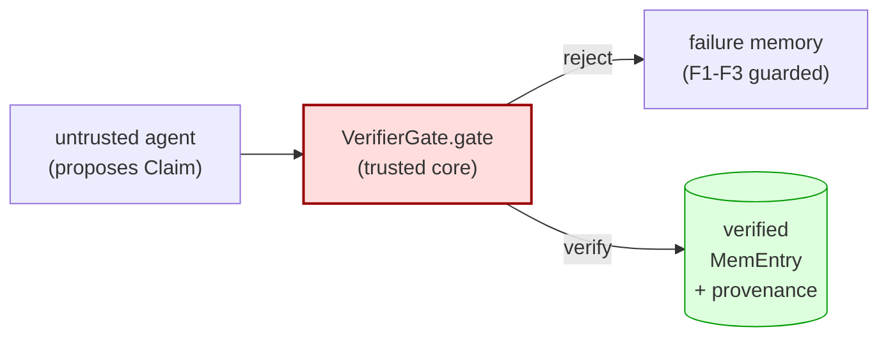

# Phase 9 — Walking Skeleton

> Design-team phase 9 of the Master Prompt brief (optional, "if you can execute code"). This file
> describes the prototype under [`/skeleton`](../skeleton) and states **exactly what was built,
> compiled and run vs. what is design-only**. Status tags:
> `[exists today]` / `[near-term]` / `[frontier]` / `[speculative]`.

## 1. What the brief asked for

A pinned Lean + Mathlib project, an orchestrator, a Lean REPL tool, a memory store, one prover loop,
and a **verifier gate with axiom audit and statement matching**, plus **adversarial cheating proofs
that must be rejected**.

## 2. Environment reality (honesty first)

The execution plan's Step 0 initially found **no** Lean toolchain (`elan`/`lake`/`lean` absent). The
skeleton was therefore first authored *unverified*. It has since been **built and run**:

- Installed **elan 4.4.0** and the pinned toolchain **`leanprover/lean4:v4.35.0`** — confirming the
  Phase-0 version pin is a real release (Lean 4.35.0, commit `eb6cafb7290e8bd5f2937522d8d804f58f02bafc`).
- `lake build` → **success** (9 jobs).
- `lake env lean tests/adversarial.lean` → **exit 0**, all six cheat cases rejected, honest case
  verified (output in §7).
- `tests/memory.lean`, `tests/leancheck.lean`, `tests/goals.lean` → **exit 0** (outputs in §7b/§7c/§7d).

Remaining environment facts:
- The machine is **not a git repository**.
- **Mathlib is deliberately not a dependency** of this project (see §5): the trusted gate needs only
  Lean core, so the trusted base stays small (invariant #1) and the build is seconds, not hours.
- There is **no interactive goal-stepping session** in the skeleton: goal states are read **one-shot**
  (`Tools/GoalState.lean`, see §7d). Stepping a proof forwards tactic-by-tactic still needs the
  `leanprover-community/repl` package or the LSP server, which remains design-only (§5–§6).

## 3. What was actually built (files)

| File | Role | Trust |
|---|---|---|
| `skeleton/lean-toolchain` | pin Lean `v4.35.0` (**verified real**) | config |
| `skeleton/lakefile.toml` | no external deps; commented Mathlib require | config |
| `skeleton/ProofAgent.lean` | library root (imports the modules) | — |
| `skeleton/ProofAgent/Spec.lean` | `ProblemSpec`, `Claim` — the untrusted input artifacts | untrusted |
| `skeleton/ProofAgent/VerifierGate.lean` | banned-token scan, statement match, axiom allow-list; total `gate` | **trusted core** |
| `skeleton/ProofAgent/Memory.lean` | append-only, content-addressed **JSONL** store + dedup `insert`, `load`, `size` | untrusted periphery |
| `skeleton/ProofAgent/Orchestrator.lean` | propose→verify→record; `verifyAndRecord` persists only on `.verified` | untrusted periphery |
| `skeleton/ProofAgent/Tools/LeanCheck.lean` | spawns the pinned `lean --json`, parses diagnostics → `CheckResult` | tool (compile oracle) |
| `skeleton/ProofAgent/Tools/GoalState.lean` | probes a statement (`example … := by skip`), parses the `unsolvedGoals` diagnostic → initial goal(s) | tool (goal reader) |
| `skeleton/ProofAgent/Tools/CheckServer.lean` | line-oriented JSON request loop (`op := check \| goals`); `lake exe checkServer` | tool server |
| `skeleton/tests/adversarial.lean` | 6 cheat proofs (must reject) + 1 honest proof (must pass) + machine-checked axiom tests | test |
| `skeleton/tests/memory.lean` | store ops, dedup, and gate→persist end-to-end | test |
| `skeleton/tests/leancheck.lean` | good / bad / unknown-tactic / `sorry` compile outcomes | test |
| `skeleton/tests/goals.lean` | initial goal read-back of a true, a false and an ill-typed statement | test |
| `skeleton/README.md` | how to run + scope/honesty | doc |

**Build/run result:** compiled with Lean 4.35.0; `lake build` succeeds (9 jobs) and all four test
scripts exit 0 (see §7, §7b, §7c, §7d).

## 4. Design mapping (what the skeleton proves about the design)

The skeleton is a *thin slice through the trusted boundary*, chosen because Phase 1/Phase 5/Phase 7
identify the gate as the load-bearing part.



It concretely exercises these design claims (each now demonstrated by a passing run):

- **Invariant #1** — the gate is total and deterministic; agents never adjudicate truth.
- **F1 (kernel bypass)** — rejected by the data-driven banned-token scan (`bannedTokens`).
- **F2 (statement drift)** — rejected by content-hash comparison against the signed `ProblemSpec`.
- **F3 (axiom inflation)** — rejected by the `{propext, Classical.choice, Quot.sound}` allow-list.
- **A1 (compiled ≠ verified)** — only `gate = .verified` appends a `verified` memory entry.
- **F7 (memory poisoning)** — `verifyAndRecord` persists only `gate = .verified` entries; rejections
  never reach the store.
- **Invariant #3 (provenance / append-only)** — `MemEntry` carries hash, producer, status; the store is
  an append-only JSONL log and `insert` never mutates existing lines.
- **Phase-5 dedup lever** — `insert` dedups by content key (a second identical insert is a no-op).
- **§5.3 Lean tool** — `LeanCheck.checkSource` compiles a snippet with the pinned `lean --json` and
  returns structured diagnostics; `checkServer` exposes it as a long-lived JSON tool server.
- **§5.3 goal state** — `GoalState.goalState` reads back a statement's *initial* goal(s) over the same
  `lean --json` plumbing (no REPL, no Mathlib); `checkServer` exposes it under `op := "goals"`. Reading
  a goal is deliberately separate from truth: a **false** statement still yields a goal (§7d).
- **A1 (compiled ≠ verified)** — the check tool *accepts* a `sorry` proof (warning only); the gate is
  what rejects it. Compilation and verification are deliberately separate stages.

## 5. What the skeleton deliberately does NOT include (and why)

| Missing piece | Reason | Where designed |
|---|---|---|
| **Interactive** goal stepping (REPL) | the *initial* goal read-back is built (`Tools/GoalState.lean`, one-shot `by skip` probe); stepping tactic-by-tactic needs a live session (`repl` package or LSP server) | Phase 3 §5.3; Phase 2 |
| Elaborated-`Expr` inspection | the textual scan is a stand-in; the real gate inspects the elaborated expression | Phase 3 §5.8 |
| **Independent re-check** (nanoda/con-leche/lean4lean) | external tools + export pipeline; is what upgrades `compiled`→`verified` (A1) | Phase 3 §5.8; Phase 5 §3.3 |
| Content-addressed store: **index / sharding** | the JSONL log + dedup exist; the content-addressed *index* and sharding are not yet built | Phase 3 §5.5; Phase 5 §3.5 |
| Mathlib integration | not needed by the gate; added when the pipeline imports it | Phase 2, Phase 6 |
| Swarm / portfolio scheduler | MVP is one loop; scaling is Phase 5/6 | Phase 2 diagram F |
| Human gates, sensor bridge, actuators | later stages (v2–v4) | Phase 6 |

## 6. How to make it real (the next 1–2 weeks of engineering)

1. Keep the pinned toolchain; add Mathlib in `lakefile.toml` and `import Mathlib...` where the
   pipeline (not the gate) needs it.
2. Replace the textual `scanBanned` with elaboration + inspection of the elaborated `Expr`
   (defeq-check against the signed spec's `Expr`), keeping `gate` total.
3. Wire `#print axioms` output into `axiomsUsed`; add the signed-policy log for exceptions.
4. Add the independent re-check step so `verified` means "exported and re-checked" (A1).
5. Add a content-addressed **index** (and sharding) over the JSONL log — the log, provenance and dedup
   already exist (`ProofAgent/Memory.lean`).
6. Extend goal introspection from **one-shot** (built: `Tools/GoalState.lean` reads a statement's
   initial goal) to **interactive stepping** — add a live session (the `leanprover-community/repl`
   package or the Lean LSP server) so the prover loop can apply one tactic and re-read the goals.

## 7. Acceptance test for Phase 9

- **Input:** `tests/adversarial.lean`.
- **Expected behaviour:** six rejections (`sorryFound`, `nativeDecideFound`, `unsafeFound`,
  `kernelBypassOption`, `statementMismatch`, `forbiddenAxiom`) followed by one `verified`; exactly one
  `verified` `MemEntry`.
- **Pass/fail metric:** all six cheats rejected **and** the honest case accepted. Any cheat accepted =
  fail (blocking).
- **Failure it guards:** F1/F2/F3/F7 — the classes that would let a false theorem be published as
  proven.
- **Status here: PASSED** on Lean 4.35.0 (`lake build` success; test exit code 0). Recorded output:

```
ProofAgent.Verdict.rejected (ProofAgent.RejectReason.sorryFound)
ProofAgent.Verdict.rejected (ProofAgent.RejectReason.nativeDecideFound)
ProofAgent.Verdict.rejected (ProofAgent.RejectReason.unsafeFound)
ProofAgent.Verdict.rejected (ProofAgent.RejectReason.kernelBypassOption)
ProofAgent.Verdict.rejected (ProofAgent.RejectReason.statementMismatch "H_signed" "H_differs")
ProofAgent.Verdict.rejected (ProofAgent.RejectReason.forbiddenAxiom "MyAxiom")
ProofAgent.Verdict.verified
ProofAgent.Verdict.rejected (ProofAgent.RejectReason.sorryFound)
[{ hash := "H_signed", statement := "∀ n : Nat, n + 0 = n", producer := "agent-02", status := "verified" }]
```

### 7b. Acceptance test for the memory store

- **Input:** `tests/memory.lean`.
- **Expected:** first `insert` appends (`true`); second identical `insert` is deduped (`false`); a
  rejected proposal is **not** persisted; an honest proposal is; reload parses the JSONL back.
- **Pass/fail metric:** dedup works **and** rejections never reach the store **and** the round-trip
  reproduces the entries.
- **Failure it guards:** F7 (memory poisoning); invariant #3 (provenance/append-only).
- **Status here: PASSED** (exit code 0). Recorded output:

```
--- direct store ops ---
insert#1 = true   (expect true)
insert#2 = false   (expect false: deduped by content key)
size      = 1     (expect 1)
--- end-to-end: gate, then persist ---
cheat  verdict = ProofAgent.Verdict.rejected (ProofAgent.RejectReason.sorryFound)   (expect rejected)
honest verdict = ProofAgent.Verdict.verified   (expect verified)
size      = 2     (expect 2: cheat NOT persisted)
--- reload from disk (JSONL round-trip) ---
  { hash := "H1", statement := "a + 0 = a", producer := "agent-02", status := "verified" }
  { hash := "H_signed", statement := "∀ n : Nat, n + 0 = n", producer := "agent-02", status := "verified" }
```

### 7c. Acceptance test for the Lean check tool

- **Input:** `tests/leancheck.lean` and a piped run of `lake exe checkServer`.
- **Expected:** `good` compiles (`ok=true`); `bad` and `unknown` fail (`ok=false`) with error
  diagnostics; `sorry` **compiles** (`ok=true`, warning only); the server answers one JSON line per
  request and rejects malformed input.
- **Pass/fail metric:** the compiler is invoked correctly, diagnostics are parsed, and the
  `compiled ≠ verified` gap is visible (the `sorry` case).
- **Failure it guards:** A1 (`compiled ≠ verified`); §5.3 (tool layer exists and is callable).
- **Status here: PASSED.** Recorded output:

```
good    ok=true   (expect true)
bad     ok=false   (expect false)
sorry   ok=true   (expect true: compiles, warning only)
unknown ok=false   (expect false)
sorry   diagnostics = #[{ severity := "warning", line := 1, column := 8, message := "declaration uses `sorry`" }]

$ '{"id":"r1","source":"theorem a : 1 + 1 = 2 := rfl"}' | lake exe checkServer
{"diagnostics":[],"id":"r1","ok":true}
```

### 7d. Acceptance test for the goal-state tool

- **Input:** `tests/goals.lean` and a piped `lake exe checkServer` run with `op := "goals"`.
- **Expected:** a well-formed statement reads back its initial goal (`ok=true`, `#goals=1`); a **false**
  statement also reads back a goal (goal reading ≠ truth); an ill-typed statement reports `ok=false`;
  multi-goal payloads split on blank lines.
- **Pass/fail metric:** a statement's initial goal is extracted and the truth-independent separation is
  visible.
- **Failure it guards:** §5.3 (the prover loop can read goals, not just diagnostics).
- **Status here: PASSED** (exit code 0). Recorded output:

```
--- simple goal ---
  statement : ∀ n : Nat, n + 0 = n
  ok        = true
  #goals    = 1
  goal      : ⊢ ∀ (n : Nat), n + 0 = n
--- arithmetic ---
  statement : 1 + 1 = 2
  ok        = true
  #goals    = 1
  goal      : ⊢ 1 + 1 = 2
--- false (still a goal) ---
  statement : 1 + 1 = 3
  ok        = true
  #goals    = 1
  goal      : ⊢ 1 + 1 = 3
--- ill-typed statement ---
  statement : List 1
  ok        = false
  #goals    = 1
  goal      : ⊢ List sorry
--- parseGoals on a multi-case payload (unit) ---
  block : case left / ⊢ 1 = 1
  block : case right / ⊢ 2 = 2

$ '{"id":"g1","op":"goals","statement":"1 + 1 = 2"}' | lake exe checkServer
{"goals":["⊢ 1 + 1 = 2"],"id":"g1","ok":true,"raw":"unsolved goals\n⊢ 1 + 1 = 2"}
```

## Self-critique (Phase 9)

- **Weakest point:** the skeleton demonstrates the gate's *policy*, not the *full pipeline* — the
  textual scan is knowingly weaker than elaborated-`Expr` inspection + independent re-check (§6).
  A passing run must **not** be read as a `verified` claim per A1.
- **What was fixed:** the project now **builds and passes** on a real, pinned Lean 4.35.0; two real
  bugs were found and fixed by the compiler (the reserved word `axiom` as a field name; a missing
  library root file), which is exactly the value of actually building it. Building the goal tool added
  a third: `show` is a reserved keyword (the test helper was renamed), and Lean's **auto-bound
  implicits** mean a bare unknown identifier in a statement still elaborates — so `GoalState`'s `ok`
  requires the unsolved-goals report to be the *only* error.
- **What was built since first draft:** the memory store is now **real** — an append-only JSONL log
  with content-addressed provenance and dedup (`ProofAgent/Memory.lean`), tested end-to-end (§7b). Its
  content key is FNV-1a, deliberately non-cryptographic for the skeleton; production uses SHA-256 over
  canonical artifact bytes. A **Lean check tool** (`Tools/LeanCheck.lean`) + **goal-state tool**
  (`Tools/GoalState.lean`) + **tool server** (`Tools/CheckServer.lean`, `lake exe checkServer`) now
  invoke the pinned compiler, parse diagnostics (§7c) and read back initial goals (§7d) — the *compile*
  and *goal-read* stages, still one-shot.
- **What remains flagged:** no **interactive** goal stepping, no Mathlib, no independent re-checker;
  `String.splitOn` being `@[extern]` is why verdicts are checked via `#eval` rather than `by decide`.
  The elaborated-`Expr` gate (kernel-reducible) is what enables machine-checked proofs about the gate
  itself. All items are on the §6 list.
