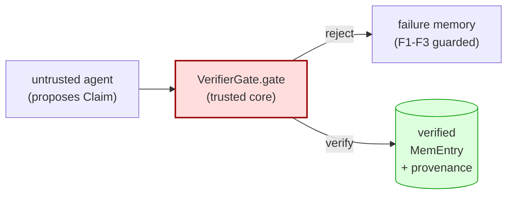

# Phase 9 — Walking Skeleton

> Design-team phase 9 of the Master Prompt brief (optional, "if you can execute code"). This file
> describes the prototype under [`/skeleton`](../skeleton) and states **exactly what was built vs.
> what is design-only**. Status tags: `[exists today]` / `[near-term]` / `[frontier]` / `[speculative]`.

## 1. What the brief asked for

A pinned Lean + Mathlib project, an orchestrator, a Lean REPL tool, a memory store, one prover loop,
and a **verifier gate with axiom audit and statement matching**, plus **adversarial cheating proofs
that must be rejected**.

## 2. Environment reality (honesty first)

Step 0 of the execution plan probed the environment:

- `git status` → **not a git repository**.
- `elan` / `lake` / `lean` → **not installed** (commands not found).

Therefore the skeleton was **authored** but **could not be built or run here**. Consequences:

- Every version pin (`lean-toolchain` = `leanprover/lean4:v4.35.0`, `lakefile.toml` Mathlib `rev`)
  is marked **UNVERIFIED** (Phase 0 also flags the Lean/Mathlib version claim).
- The `tests/adversarial.lean` cases are **written but not executed**; their *expected* verdicts are
  documented inline.
- There is **no Lean REPL tool** in this skeleton (it needs a running toolchain); the design for it is
  in Phase 3 (§5.3) and Phase 2. This is a deliberate, flagged gap.

## 3. What was actually built (files)

| File | Role | Trust |
|---|---|---|
| `skeleton/lean-toolchain` | pin the Lean version (UNVERIFIED) | config |
| `skeleton/lakefile.toml` | depend on Mathlib (UNVERIFIED rev) | config |
| `skeleton/ProofAgent/Spec.lean` | `ProblemSpec`, `Claim` — the untrusted input artifacts | untrusted |
| `skeleton/ProofAgent/VerifierGate.lean` | banned-token scan, statement match, axiom allow-list; total `gate` | **trusted core** |
| `skeleton/ProofAgent/Orchestrator.lean` | propose→verify→record; verified-only `MemEntry` provenance | untrusted periphery |
| `skeleton/tests/adversarial.lean` | 6 cheat proofs (must reject) + 1 honest proof (must pass) | test |
| `skeleton/README.md` | how to run + scope/honesty | doc |

## 4. Design mapping (what the skeleton proves about the design)

The skeleton is a *thin slice through the trusted boundary*, chosen because Phase 1/Phase 5/Phase 7
identify the gate as the load-bearing part.

It concretely exercises these design claims:

- **Invariant #1** — the gate is total and deterministic; agents never adjudicate truth.
- **F1 (kernel bypass)** — rejected by data-driven banned-token scan (`bannedTokens`).
- **F2 (statement drift)** — rejected by content-hash comparison against the signed `ProblemSpec`.
- **F3 (axiom inflation)** — rejected by the `{propext, Classical.choice, Quot.sound}` allow-list.
- **A1 (compiled ≠ verified)** — only `gate = .verified` appends a `verified` memory entry.
- **F7 (memory poisoning)** — `Orchestrator.step` leaves memory unchanged on rejection.
- **Invariant #3 (provenance)** — `MemEntry` carries hash, producer and status.

## 5. What the skeleton deliberately does NOT include (and why)

| Missing piece | Reason | Where designed |
|---|---|---|
| Lean REPL tool server | needs a live toolchain; out of scope for an unbuilt skeleton | Phase 3 §5.3; Phase 2 |
| Elaborated-`Expr` inspection | the textual scan is a stand-in; real gate inspects the elaborated expression | Phase 3 §5.8 |
| **Independent re-check** (nanoda/con-leche/lean4lean) | external tools + export pipeline; is what upgrades `compiled`→`verified` (A1) | Phase 3 §5.8; Phase 5 §3.3 |
| Content-addressed JSONL store | in-memory `Store` used instead | Phase 2, Phase 3 §5.5 |
| Swarm / portfolio scheduler | MVP is one loop; scaling is Phase 5/6 | Phase 2 diagram F |
| Human gates, sensor bridge, actuators | later stages (v2–v4) | Phase 6 |

## 6. How to make it real (the next 1–2 weeks of engineering)

1. Install `elan`, pin the toolchain to the installed version, `lake exe cache get`, `lake build`.
2. Replace the textual `scanBanned` with elaboration + inspection of the elaborated `Expr`
   (defeq-check against the signed spec's `Expr`), keeping `gate` total.
3. Wire `#print axioms` output into `axiomsUsed`; add the signed-policy log for exceptions.
4. Add the independent re-check step so `verified` means "exported and re-checked" (A1).
5. Swap the in-memory `Store` for an append-only JSONL + content-addressed index.

## 7. Acceptance test for Phase 9

- **Input:** `tests/adversarial.lean`.
- **Expected behaviour:** six rejections (`sorryFound`, `nativeDecideFound`, `unsafeFound`,
  `kernelBypassOption`, `statementMismatch`, `forbiddenAxiom`) followed by one `verified`; exactly one
  `verified` `MemEntry`.
- **Pass/fail metric:** all six cheats rejected **and** the honest case accepted. Any cheat accepted =
  fail (blocking).
- **Failure it guards:** F1/F2/F3/F7 — the classes that would let a false theorem be published as
  proven.
- **Status here:** *authored, not executed* (no toolchain). Must be run before the MVP exit gate.

## Self-critique (Phase 9)

- **Weakest point:** the skeleton is **unbuilt**, so it is evidence of *design clarity*, not of
  *working code*. This is flagged in three places (here, `skeleton/README.md`, and the file header).
- **What was fixed:** the gate's cheat surface is enumerated *as data* (`bannedTokens`,
  `RejectReason`) so extending it is auditable, matching the brief's "small, auditable core".
- **What remains flagged:** the textual scan is knowingly weaker than elaborated-`Expr` inspection;
  §6 step 2 is the fix. Until then, do **not** treat a passing skeleton run as a `verified` claim per
  A1 — it demonstrates the *policy*, not yet the *full pipeline*.
